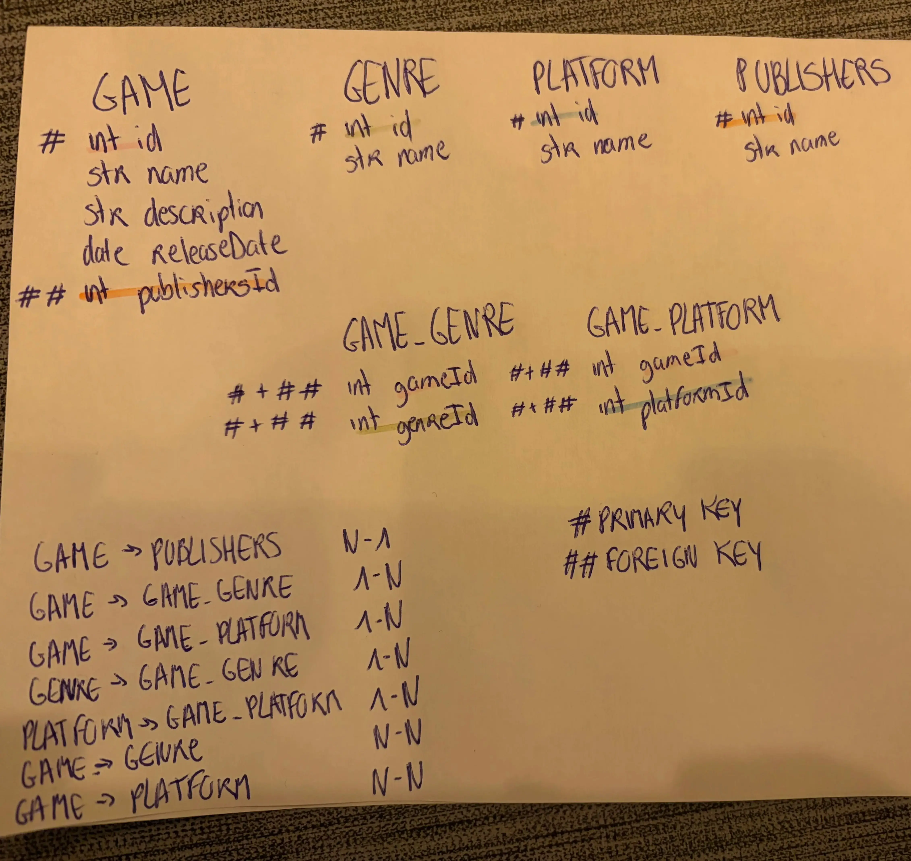
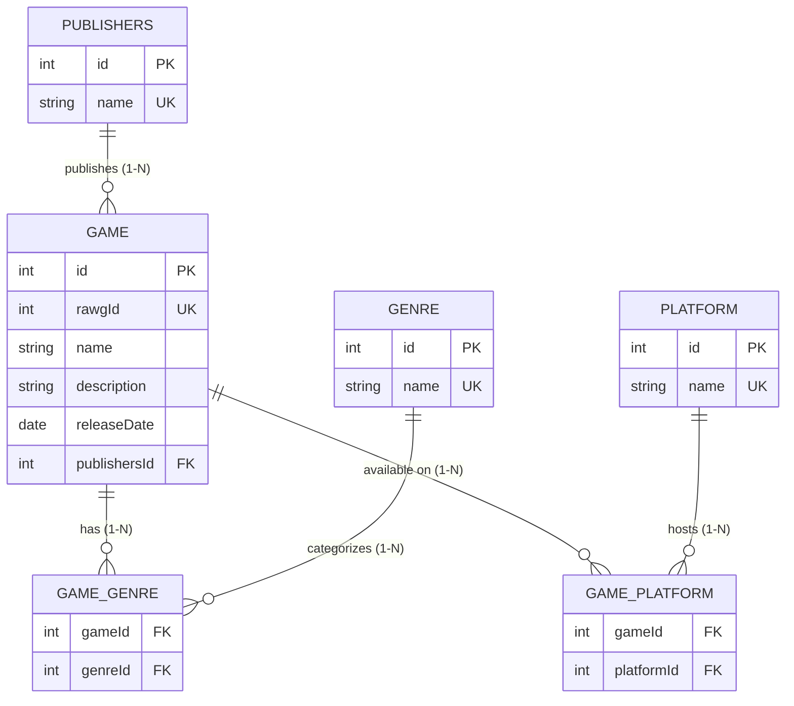

# Game API Platform
This application is a listing of video games built using the RAWG API that users can add to create their own list.

## Table of Contents

- [Installation & Start](#installation--start)
- [Diagrams](#diagrams)
- [Sources](#sources)
- [Import Commands](#import-commands)
- [Table Mapping](#table-mapping)
- [Table Rules ETL](#table-rules-etl)
- [AI Used](#ai-used)
- [Authors](#authors)

## Installation & Start
- Download the folder or clone the repository using:
```
git clone https://github.com/LeoVigin/games-api-platform.git
```

- Open the project in any local development server
- Run the following command to install the dependencies:

```
composer install
```

- Generate your app key with:
```
php -r "echo bin2hex(random_bytes(16));"
```

- Create a .env.dev file at the root of the project and add:
```
APP_SECRET=<your key>
RAWG_API_KEY=<your api key>
```

- Then set up your database with:
```
php bin/console doctrine:migrations:migrate
```

- Run the project with:
```
symfony serve -d
```
## Diagrams
### Initial Handmade Sketch
</img>

### Updated Mermaid ER Diagram



## Sources

- The project details are in this [workbook](https://devinci-my.sharepoint.com/personal/gabriel_lefebvre_fristot_edu_devinci_fr/Documents/mapping-architecture-donnees.xlsx?d=w189c88ab53184f17a1ef24a9b8965f7f&csf=1&web=1&e=8JtBYd)
- The Rawg API doc [here](https://rawg.io/apidocs)


## Import Commands

- You can then import your games using:
```
php bin/console app:import-games "action"
php bin/console app:import-games "family"
php bin/console app:import-games "indie"
```


## Table Mapping

| Target entity | Target property | Doctrine type | Length | Nullable | Unique | Validator constraints | Read groups | Write groups | Transformation rule | Status | Notes |
|---|---|---|---|---|---|---|---|---|---|---|---|
| Game | id | integer | | No | Yes | none (auto-incremented) | game:read | none | auto-generated primary key | Mapped | Primary key of the Game entity |
| Game | rawgId | integer | | Yes | Yes | none (never written by the API) | none (hidden) | none | none (from source `id`, e.g. `3328`) | Mapped | Natural key: prevents importing the same game twice |
| Game | name | string | 255 | No | No | NotBlank, Length(max: 255) | game:read | game:write | truncated to 255 characters; no title = ignored (from source `name`) | Mapped | Game text field, stored as is |
| Game | description | string | 400 | No | No | NotBlank, Length(max: 400) | game:read | game:write | null if missing (from source `description`) | Mapped | Description text field: stored as is |
| Game | releaseDate | date | | No | No | NotBlank | game:read | game:write | null if missing (from source `released`) | Mapped | Date (YYYY-MM-DD format) |
| Platform | name | string | 100 | No | No | NotBlank, Length(max: 100), UniqueEntity | platform:read, game:read | platform:write, game:write | starts with a capital letter; found or created (from source `platform`) | Relation | Becomes the Platform entity, linked by `Game.platform` (`ManyToMany`) |
| Genre | name | string | 100 | No | Yes | NotBlank, Length(max: 100), UniqueEntity | genre:read, game:read | genre:write, game:write | first 4 characters, lowercase; found or created (from source `genre`) | Relation | Becomes the Genre entity, linked by `Game.genre` (`ManyToMany`) |
| Publishers | name | string | 255 | No | Yes | NotBlank, Length(max: 255) | publishers:read, game:read | publishers:write, game:write | found or created (import memory); if missing from source, named `"Unknown"` (from source `publishers`) | Relation | Becomes the Publishers entity, linked by `Game.publishers` (`ManyToOne`) |


## Table Rules ETL

| # | Type | Rule | Source field(s) | Why | Where in the code |
|---|---|---|---|---|---|
| E | Extract | Fetch games from RAWG API by query/subject, keeping only useful fields | id, name, description, released, platforms, genres, publishers | limit volume and noise | E - EXTRACT |
| T1 | Filter | No name, no description, no date: the game is ignored | name, description, releaseDate | unusable, and forbidden by our constraints | T - rule 1 |
| T2 | Deduplicate | If `rawgId` already exists in the database, the game is ignored | rawgId | re-running the import must not duplicate anything | T - rule 2 |
| T3 | Link | Publisher by name, otherwise created (import memory) | publishers | one publisher = one row | T - rule 3 |
| T4 | Normalise | First 4 subjects, lowercase, found or created as genres | genre | "Action" and "action" are the same genre | T - rule 4 |
| T5 | Normalise | First 4 platforms, starting with a capital letter, found or created as platforms | platform | "PC" and "pc" are the same platform | T - rule 4 |
| T6 | Truncate | Title cut to 255 characters | name | the import does not go through validation | T - rule 5 |
| T7 | Truncate | Description cut to 400 characters | description | the import does not go through validation | T - rule 6 |
| L | Load | persist each game, a single flush at the end | | one single round trip to the database | L - LOAD |


## AI Used

**EcoGPT** for:
- Writing the ETL code
- Debugging the ETL code

**EcoGPT & Gemini** for the README:
- Creating the Mermaid diagram (updated from the handmade version, adding `rawgId` which was missing from the sketch)
- Generating the mapping and ETL tables (from the Excel screenshot)
- Checking whether anything was missing against the instructions
- Fixing spelling mistakes and typos


## Authors

@LeoVigin <br>
